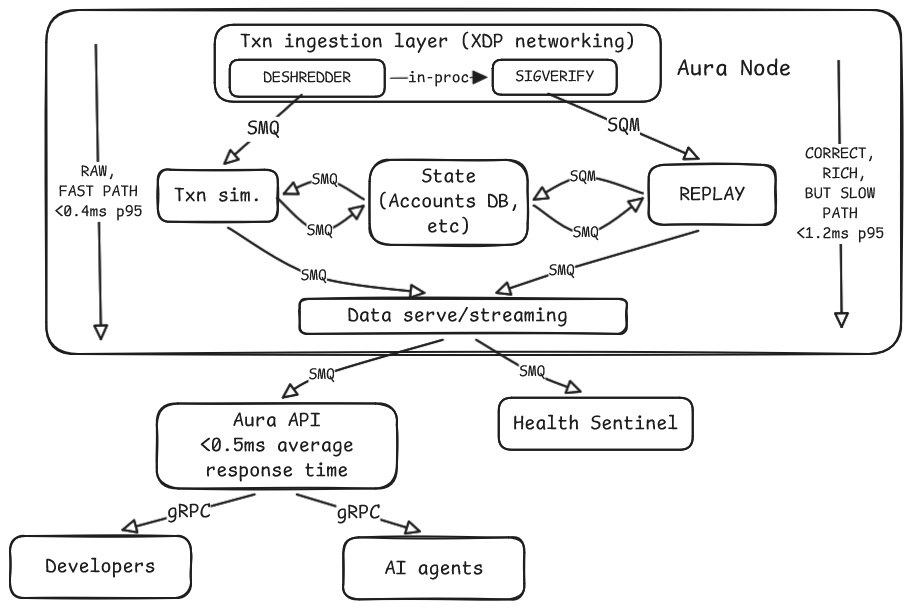

# Aura API Client

Aura is a low-latency Solana trading platform that gives bots, AI agents, and power users direct API control over trading, sniping, copy-trading, limit orders, wallets, nonces, and execution routing.

- Landing page: [https://aura.rehab](https://aura.rehab)
- API endpoint: `http://trade.aura.rehab:40051`
- Telegram bot: [@trade_with_aura_bot](https://t.me/trade_with_aura_bot) — get an API key in the `API | Extension` tab. Use it with the `auth` header in gRPC metadata.
- Contact: [@saul_goodman_aura](https://t.me/saul_goodman_aura)

The Telegram bot is the fastest way to start using Aura. The API is for builders, power users, and automation: it exposes the same product surface as the Telegram UI, but with finer and richer control.

## Why Aura Is Fast


Aura uses two data paths inside the node:

- A raw fast path for low-latency transaction simulation and early data delivery.
- A richer replay-backed path for more complete and correct state.
- Shared-memory queues connect ingestion, simulation, replay, state, streaming, health checks, and the public API with minimal overhead.
- The Aura API exposes this data over gRPC to developers and AI agents.

Latency numbers are measured inside Aura infrastructure and depend on region, load, requested endpoint, and client location.

## What the API gives you

The Aura API gives full control over the trading features behind the bot (and some data endpoints too), including:

- All kinds of trades through Aura's trading router: buys, sells, Buy Dip, DCA, and other execution flows. Arbitrage endpoint coming soon.
- Utility transactions: wrap SOL, unwrap WSOL, open token accounts, and open Aura utility accounts.
- Limit order management: list, place, delete, and clear orders.
- More than 100 order variants, including Buy Dip, DCA, delayed orders, trailing orders, and other advanced limit order types.
- Live user activity streaming for trade callbacks, confirmations, and account events.
- Token status, metadata, most-liquid pool lookup, trade stats, and position data.
- Full wallet state queries across user wallets.
- Sniper configuration management: create, duplicate, enable, disable, delete, clear, inspect, and update snipe tasks.
- Snipe task controls for tracked mints, tracked devs, blacklists, limit orders, and buy/sell transaction processors.
- Copy-trading configuration management: create, duplicate, enable, disable, delete, clear, inspect, and update copy-trade tasks.
- Copy-trading controls for watched wallets, buy/sell blacklists, limit orders, and buy/sell transaction processors.
- Wallet operations: add, remove, switch active wallet, withdraw, and rotate/change API keys.
- Nonce management for controlled execution flows.
- Fine-grained DEX compute-unit configuration for faster and cheaper execution.
- Transaction processor stats so clients can make routing and execution decisions with more context.

In short: the API is the full Aura control surface. If you want custom dashboards, automated strategies, your own execution rules, external alerts, or deeper integrations, use the API.

## This Repository

This crate contains the generated/common Rust layer used to talk to Aura services:

- `aura_protos/protos/` contains the protobuf service and type definitions.
- `src/client/` exposes typed gRPC clients for trading, sniping, copy trading, limit orders, and utilities.
- `src/client_ext/` contains helper extensions for common client-side formatting and operations.
- `src/consts.rs` keeps public Aura links and protocol limits in one place.

Package name: `aura_api_client`

## Palantir indexing client

The indexing API is separate from the trading client and opt-in:

```toml
aura_api_client = { git = "https://github.com/in-aura-we-trade/aura_api_client", default-features = false, features = ["palantir"] }
```

Use `aura_api_client::palantir::{PalantirRpcClient, GetMint, SubscribeTrades}`.
Messages are also available under `palantir::types`. Shared types such as
`DexType`, `TradeType`, `MigrationStatus`, and `ProcKind` are re-exported from
`crate::types` at `palantir`'s root and under `palantir::common`; no duplicate
Rust definitions or conversions are needed. The feature enables shared
`api-types`, but not the trading RPC clients. Enable `palantir` alongside
the default features when both indexing and trading clients are needed.
Connect to your deployed Palantir gRPC endpoint; authentication uses the
`x-api-key` metadata header with a Palantir API key (not a trading API key).


## Services

The public client groups the API into five service clients:

- `aura` - core trading, token data, wallet state, and user activity.
- `snipe` - sniper task configuration and controls.
- `ct` - copy-trading task configuration and controls.
- `limit_orders` - limit order reads and writes.
- `utils` - wallets, API keys, WSOL utilities, nonce handling, compute-unit settings, and processor stats.

## API Notes

By default, the API allows 4 requets per second per API key and per IP address.

To receive live notifications such as trade updates, limit order executions, and errors, clients must subscribe to the `UserActivity` stream. Keep the stream alive by sending a ping every 10 seconds.

### Task address allowances

Each user has a combined allowance of 4,000 CA (mint) and developer trigger
entries across all snipe tasks, and a separate allowance of 4,000 followed
wallet entries across all copytrade tasks. There is no additional per-task
address cap: one task may use the entire allowance. Duplicate addresses within
one list count once; the same address in different tasks or trigger lists
counts once per membership. Disabled tasks still consume their configured
entries. Deleting entries/tasks releases capacity; duplicating a task requires
capacity for its copied entries. Blacklist, quote-whitelist and task-count
limits are unchanged.

### Copy-trade sell trigger amounts

`CtTaskValues.min_sell_amount` and `max_sell_amount` filter the watched wallet's
sell, not the size of the copied order. `sell_amount_filter_mode` selects
`Value` (gross routed proceeds before router fees) or `Percentage`
(the fraction of the watched wallet's pre-transaction token balance, from `0`
to `1`). Bounds are inclusive; `0` disables that bound, and both bounds default
to disabled. The filter applies to the original watched sell even when
reverse-copy turns the copied action into a buy.

Value bounds independently select USD or SOL using `min_sell_amount_quote`
and `max_sell_amount_quote`: `Some(QuoteKind::Usd)` means USD,
`Some(QuoteKind::Sol)` or the legacy default `None` means SOL. Percentage
bounds must use `None`. Telegram accepts `0.001$` as USD and bare `0.1` as SOL.
Same-currency bounds must satisfy minimum <= maximum when maximum is enabled.
Mixed USD/SOL bounds are checked independently against the live sale value;
their relative ordering depends on the current exchange rate.

Update them with `CtUpdateField::MinSellAmount { amount, mode, quote }` and
`MaxSellAmount { amount, mode, quote }`. The supplied mode must match the current
configuration, so a stale editor cannot reinterpret an amount in another unit.
`SellAmountFilterMode(mode)` switches units and clears both bounds and quote currencies when the mode
changes. When setting a range and switching units in one `CtUpdate`, put the
mode update first. Missing balance or conversion data skips the trigger only
when its corresponding filter is active.

## Quick Start

Add the client from Git:

```toml
[dependencies]
aura_api_client = { git = "https://github.com/in-aura-we-trade/aura_api_client" }
```

Get an API key from [@trade_with_aura_bot](https://t.me/trade_with_aura_bot) in the API | Extension tab.

Use it in gRPC metadata:

`auth: <API_KEY>`

Public endpoint:
`http://trade.aura.rehab:40051`

## Security Notes

Aura API keys can control trading actions through your Aura account. Treat them like private credentials.

- Do not commit API keys.
- Do not share API keys with untrusted tools or agents.
- Rotate/change keys from the Telegram bot if a key is exposed.
- Keep `UserActivity` subscribed so your client receives confirmations, errors, and account events.


## Roadmap

### Built

- Live Solana trading platform
- Enterprise-grade trading API
- On-chain DEX router
- 200+ limit order types
- Sniper automation
- Copy-trading automation
- Custom low-latency RPC node
- MCP for AI agents

### Coming next

- Arbitrage endpoint
- Web extension
- Web UI

## Links
- Aura: [https://aura.rehab](https://aura.rehab)
- API: `http://trade.aura.rehab:40051`
- Telegram bot: [https://t.me/trade_with_aura_bot](https://t.me/trade_with_aura_bot)
- Telegram group: [https://t.me/trade_with_aura](https://t.me/trade_with_aura)
